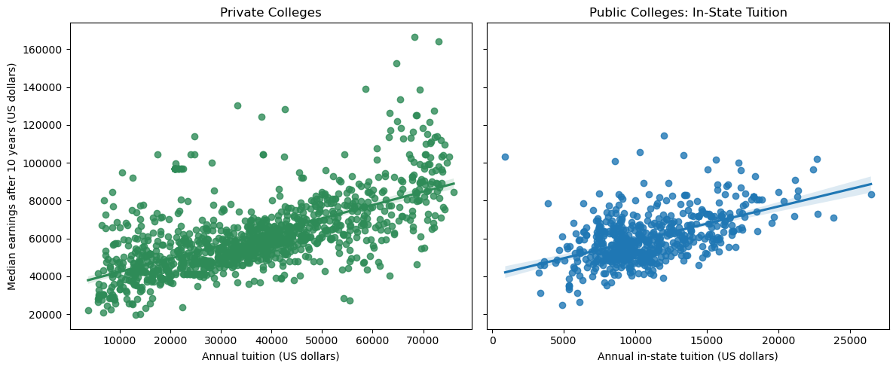
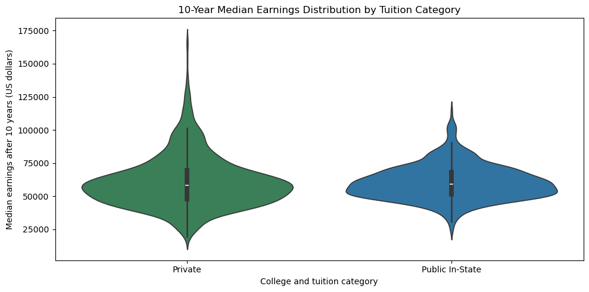
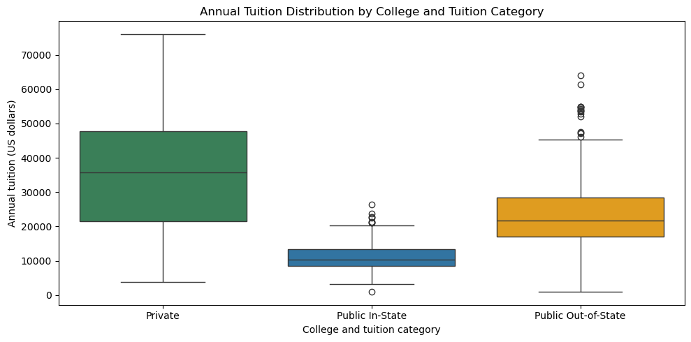

# CISC7204 Assignment 02 — College Tuition and Earnings

This folder contains the Assignment 02 proposal, Jupyter notebook, source extract, cleaned data, results report, and visualizations saved in the notebook.

## Research question

Is annual undergraduate tuition associated with the median earnings of students who are working and not enrolled 10 years after entering U.S. four-year colleges, and does this relationship differ between public and private institutions?

## Data source and responsible use

The institution-level CSV extract was downloaded from the [U.S. Department of Education College Scorecard data portal](https://collegescorecard.ed.gov/data/). When checked on 2026-10-29, the portal stated that the data were last updated on 2026-10-15; the exact release date of the archived CSV used here has not been verified. The analysis uses aggregate institutional measures, including tuition and median earnings ten years after entry, and does not use individual student records. Consult the official source page and its current data-use notice before redistributing the archived extract outside this coursework.

## Methods and tools

The analysis keeps institutions whose predominant degree is bachelor's degree (`PREDDEG == 3`), converts suppressed earnings values to missing, removes missing or non-positive tuition and earnings values, and maps control codes to Public or Private. Private combines for-profit and nonprofit institutions. The notebook uses Python, pandas, NumPy, and Matplotlib to clean the data, calculate group summaries and Pearson correlations, and create the figures.

## Findings

The cleaned institution-level sample contains **1,731 institutions**: 566 public and 1,165 private.

| Institution type | Institutions | Median in-state tuition | Median 10-year earnings | Tuition/earnings Pearson r |
| --- | ---: | ---: | ---: | ---: |
| Public | 566 | $10,330 | $59,272 | 0.523 |
| Private | 1,165 | $35,760 | $58,029 | 0.644 |

In this filtered sample, tuition and 10-year median earnings have a positive association in both groups. The association is stronger for private institutions in this descriptive comparison. Median earnings are similar across the groups despite the much higher median private tuition. These results describe this dataset and do not show that tuition causes later earnings.

## Visualizations

## Limitations

The data are institution-level aggregates, so they cannot describe individual students or establish an individual return on tuition. Tuition and earnings can represent different cohorts and are not adjusted for inflation, field of study, geography, preparation, selectivity, aid, or living costs. The analysis includes predominantly four-year institutions with usable reported values; excluded and suppressed values may reduce representativeness. The combined Private category includes nonprofit and for-profit institutions. Pearson correlations and fitted trend lines summarize association and can be affected by outliers and confounding variables.

## Reproduce

From this directory, install the repository-level dependencies, then open CISC7204-Assgn02-Pair14-CollegeTuition-Earnings-Analysis.ipynb in Jupyter and run its cells from top to bottom. The visualizations above are the notebook’s saved outputs; RESULTS.md records the findings and limitations.

## Status

**Proposal and exploratory analysis — ongoing.** Future work could add covariates such as field of study, geography, selectivity, aid, and net price before making stronger comparisons.
