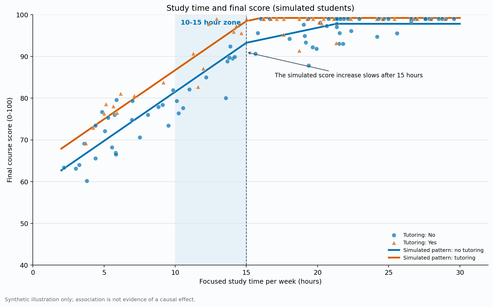
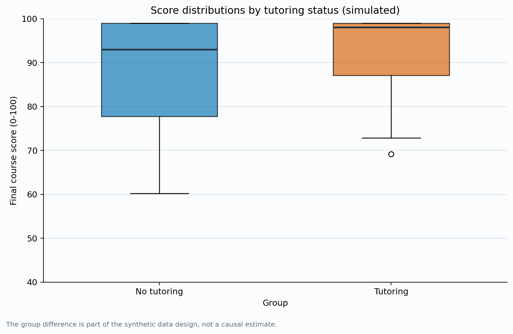

# Learning Time and Learning Outcomes

**Project status:** Completed simulation-based learning project.

## Research question

In a hypothetical student sample, how is focused weekly study time associated with final course scores, and how do scores compare between students with and without tutoring?

## Findings

Scores rise more quickly up to about 15 study hours per week and then rise more slowly. The tutoring group is generated with an approximately five-point score offset at the same study time. These are properties of the simulated data, not empirical findings about real students.






## Reproduce

Install the dependencies and run:

```bash
python -m pip install -r requirements.txt
python src/analyze.py
```

The project uses a fixed random seed and contains no real student records or personal information.

- [Repository](https://github.com/mc66006/data-science-project)
- [Portfolio](https://mc66006.github.io/data-science-portfolio/)
