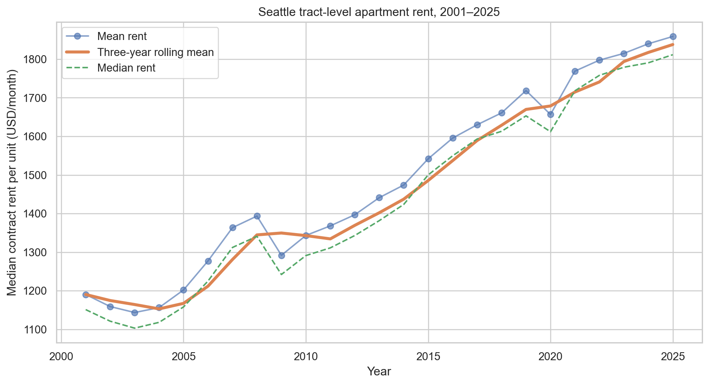
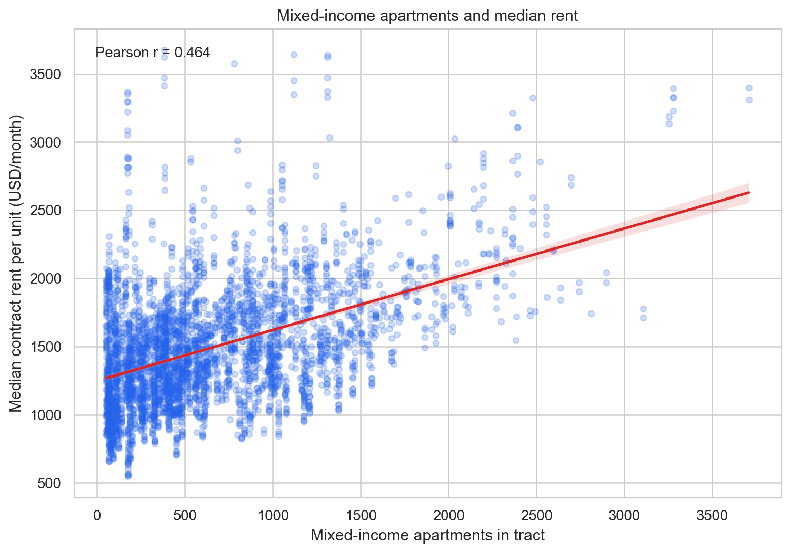
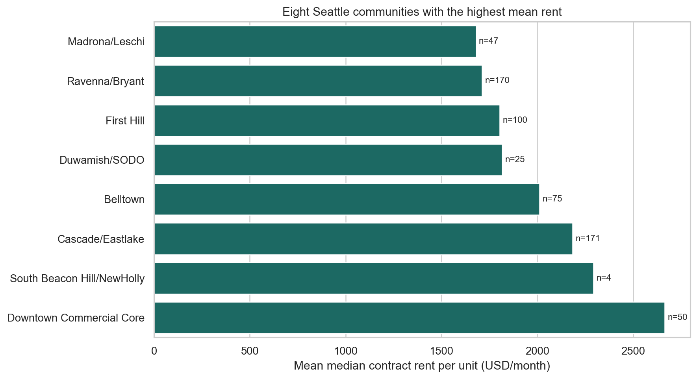
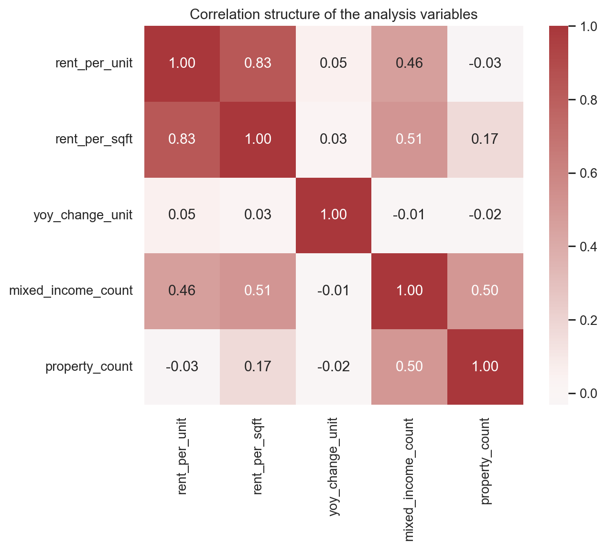

# Assignment 01 — Seattle Apartment Rent and Mixed-Income Housing

This folder contains the CISC7204 Assignment 01 proposal, exploratory notebook, publicly downloaded source data, a reproducible analysis script, and generated visualizations.

## Research question

Across Seattle census tracts, how are the number of mixed-rate or mixed-income apartments and apartment rent levels associated? How does that tract-level count relate to year-over-year rent growth?

## Data source and responsible use

The rent table is downloaded from Seattle Open Data’s [Apartment Market Rent Prices by Census Tract dataset](https://data.seattle.gov/d/h27p-5k3i). The companion housing table comes from [Single-Family Home Flips by Census Tract](https://data.seattle.gov/d/e9ve-4v8v). The portal credits CoStar Group data prepared by the City of Seattle Office of Planning and Community Development for the rent indicator and King County Assessor records for the home-flip indicator. The archived CSVs are used for this coursework. The portal is publicly accessible, but its current terms and any third-party restrictions should be checked before external redistribution. The analysis uses aggregate tract observations rather than individual households.

## Methods and tools

The analysis standardizes column names and numeric types, removes incomplete analysis rows and non-positive rent observations, summarizes rent over time and by community, and compares rent with mixed-income apartment counts. It uses Python, pandas, NumPy, Matplotlib, Seaborn, and scikit-learn. The script reports Pearson correlations and evaluates an exploratory quadratic model with random and time-based splits.

## Findings

- The downloaded source contains 4,500 rows; 3,931 positive-rent observations remain after cleaning, spanning 160 tracts.
- Mean monthly contract rent per unit is approximately **$1,486** and the median is approximately **$1,432**.
- Mixed-income apartment count has a positive cross-sectional association with rent level (**r = 0.4643**) and nearly no linear association with year-over-year rent growth (**r = -0.0136**).
- The quadratic model reports **R² = 0.454** for a random split and **R² = 0.479** for a time-based split. These are exploratory predictive checks, not causal evidence.

The results suggest that mixed-income apartment count may co-vary with rent level, but they do not show that mixed-income housing raises rents. Tract size, neighborhood location, property mix, and other omitted factors may explain part of the association.

## Visualizations









## Limitations

The analysis uses aggregate tract observations rather than individual households, so it cannot establish household-level effects. The associations are observational and may be affected by omitted neighborhood, property, demographic, and market factors. The archived extracts and their current third-party usage conditions should be checked before redistribution. The predictive scores should not be interpreted as causal or out-of-sample policy evidence.

## Reproduce

From this directory, install the repository-level dependencies and run:

```bash
python -m pip install -r ../requirements.txt
python analyze_seattle_rent.py
```

The script reads `seattle_rent.csv` and recreates the figures in `figures/`. Open `seattle_rent.ipynb` in Jupyter to review the exploratory notebook.

## Status

**Proposal and exploratory analysis — ongoing.** Future work could add more covariates, document the archived source releases more fully, and test the model on a later holdout period.
