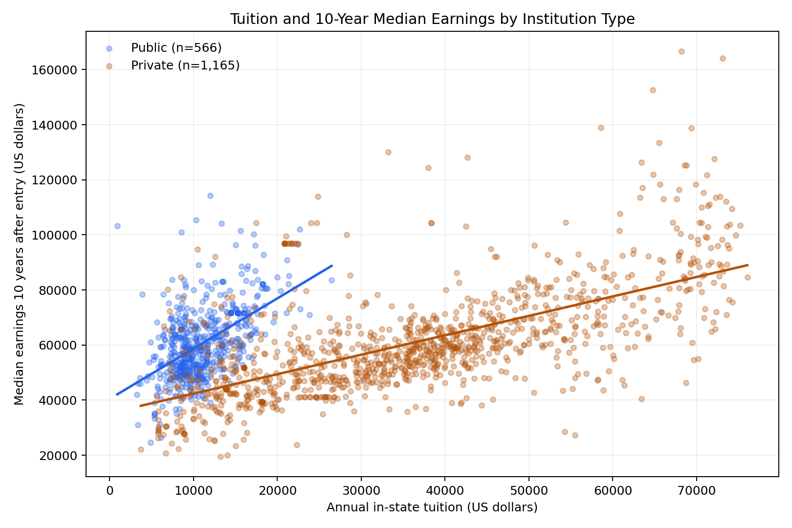
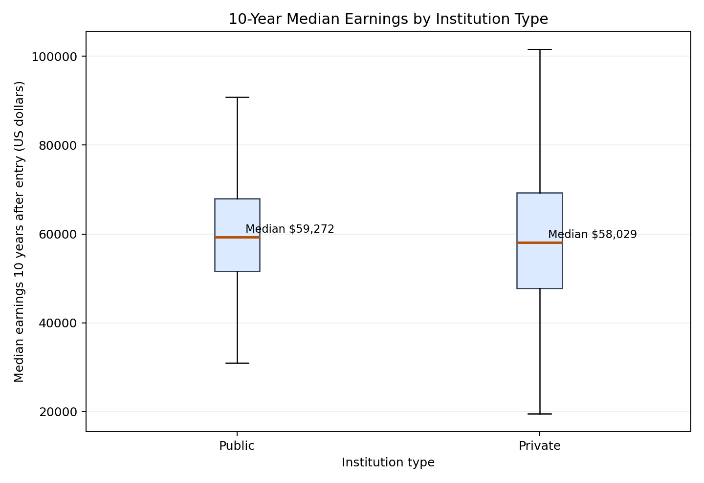

# College Tuition and Graduate Earnings

This is the **Assignment 02 proposal project** for CISC7204. It is the proposal-stage project that precedes the final portfolio presentation.

## Research question

Is annual undergraduate tuition associated with median earnings ten years after entry, and does the relationship differ between public and private four-year institutions?

## Findings preview

The cleaned sample contains 1,731 institutions. Tuition and ten-year median earnings show positive descriptive associations within both public and private institutions. These results are exploratory and do not establish that tuition causes later earnings.

## Materials

- [Revised project proposal](CISC7204-Assgn02-Pair14-RevisedProjectProposal.docx)
- [Analysis notebook](CISC7204-Assgn02-Pair14-CollegeTuition-Earnings-Analysis.ipynb)
- [Results and limitations](RESULTS.md)
- [Reproduction script](analyze_college_scorecard.py)
- [Cleaned data](cleaned_data.csv)
